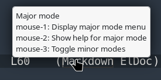
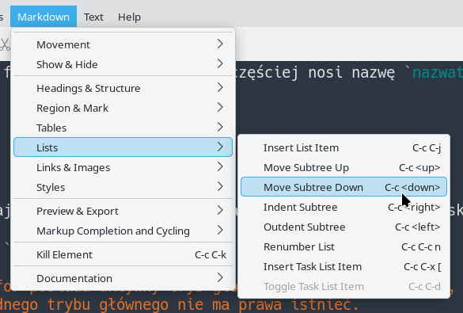

No, this is not going to be an episode about the competition or its operating modes — the one where in one mode you are allowed to type, in another you may only move the cursor, and in the third you are expected to cry.

This time we are talking about Emacs modes.

# What Is a Mode in Emacs?

Modes change the way Emacs behaves in the current buffer or, in some cases, throughout the entire session.

The most important one is the **major mode**. It tells Emacs what kind of thing the current buffer contains and how that content should be handled.

On top of that, we may enable any number of **minor modes**, each adding some specific functionality.

A mode may affect, among other things:

- how content is displayed,
- syntax highlighting,
- indentation,
- available commands,
- key bindings,
- menus,
- the behavior of various editor functions.

So talking merely about a "file type" would be too narrow.

Emacs displays plenty of things in buffers that are not files at all.

> And since we have just learned the basics of Lisp: an Emacs mode is, first and foremost, a respectable amount of Emacs Lisp code.

# Major Mode

Every buffer has exactly **one** active major mode.

For example:

```text
python-mode
markdown-mode
emacs-lisp-mode
text-mode
fundamental-mode
```

The major mode determines the basic way Emacs treats the contents of the entire buffer.

You do not enable another major mode alongside the first one.

You replace one with another.

# Minor Modes

Alongside the major mode, multiple minor modes may be active at the same time.

They add individual pieces of functionality.

Examples?

Certainly:

```text
display-line-numbers-mode
flyspell-mode
auto-fill-mode
font-lock-mode
```

One may display line numbers.

Another checks spelling.

A third automatically wraps text.

A fourth provides syntax highlighting.

And all of them may operate at the same time as:

```text
markdown-mode
```

or:

```text
python-mode
```

# Enabling a Mode

A mode normally provides a function used to activate it.

For major modes, the function usually has exactly the same name as the mode itself.

So we may run:

```text
M-x python-mode
```

and watch the Best of All Editors attempt to interpret the current buffer as Python code.

Every buffer always has some major mode.

If Emacs cannot find anything more suitable, it may end up using the most basic one:

```text
fundamental-mode
```

> A buffer without an active major mode is not really a normal state of affairs. Calling another major mode simply replaces the current one.

# What Mode Are We in This Year, My Lord?

To inspect the active modes, use:

```text
M-x describe-mode
```

or, much more conveniently:

```text
C-h m
```

Emacs displays documentation for the current major mode and the relevant active minor modes.

For example, this article is being written in Markdown.

The file is:

```text
index.md
```

Emacs has selected `markdown-mode`, and `describe-mode` shows, among other things:

- **Major mode markdown-mode** — documentation, commands, key bindings, and other information about the major mode,
- **Local minor mode auto-save-mode** — information about automatic saving,
- **Local minor mode font-lock-mode** — syntax highlighting and related settings,
- **Global minor mode blink-cursor-mode** — blinking cursor behavior,
- **Global minor mode show-paren-mode** — matching-parenthesis highlighting,
- **Global minor mode tooltip-mode** — pop-up tooltips.



And another dozen or so.

`markdown-mode` also provides its own menu:



If all we want is the symbol naming the current major mode, we can also evaluate:

```text
M-: major-mode RET
```

and get something like:

```text
markdown-mode
```

> It is worth remembering the distinction between local and global minor modes. A local minor mode affects a particular buffer. A global minor mode operates at session level or manages corresponding behavior across multiple buffers.

# How Does Emacs Know?

How does Emacs know which major mode a file needs?

During ordinary day-to-day use of the One True Editor, it may seem that it simply guesses remarkably well.

It does not.

Emacs has several sources of information and checks them according to a defined set of rules.

In simplified form, it considers:

1. an explicit mode specified by file-local variables,
2. directory-local settings, including a directory-local `auto-mode-alist`,
3. the shebang and `interpreter-mode-alist`,
4. special rules examining file contents,
5. `auto-mode-alist`, based on file names,
6. fallback content-detection rules,
7. a default mode.

So the filename is important.

But it is far from being the only source of information.

# File-Local Variables — At the Beginning

A particular file may tell Emacs directly:

> I want to use this mode.

This is done with **file-local variables**.

For example:

```text
# -*- mode: python -*-
```

Emacs recognizes the special section between:

```text
-*-
```

and interprets `mode` as the requested major mode.

This declaration is usually placed inside a comment appropriate for the language of the file, so that the line remains valid syntax.

More than one setting may be provided:

```python
# -*- mode: python; python-indent-offset: 4; indent-tabs-mode: nil -*-
```

Here:

```text
mode: python
```

selects the major mode,

```text
python-indent-offset: 4
```

sets Python indentation width,

and:

```text
indent-tabs-mode: nil
```

tells Emacs to use spaces rather than TAB characters when creating indentation.

More generic variables may be used too:

```text
# -*- mode: yaml; tab-width: 2; indent-tabs-mode: nil -*-
```

Just remember that `tab-width` primarily controls how wide an existing TAB character is displayed. It does not automatically mean "YAML indentation width is two spaces."

> Mode-specific settings are best discovered through that mode's documentation. `C-h m` is an excellent place to start.

Use cases?

Many.

Working with a team on the same file?

You can define once and for all what that particular file is supposed to be and which local settings should apply to it.

# File-Local Variables — At the End

If there are more settings, or if squeezing everything into the first line becomes unpleasant, a special block may be placed at the end of the file:

```text
# Local Variables:
# mode: python
# tab-width: 48
# indent-tabs-mode: nil
# End:
```

Yes.

`48`.

I am not judging.

They are local settings.

Use cases?

Many.

Working with a team on the same...

Right.

We already did this part.

# Directory-Local Variables

Similar settings can be defined for an entire directory tree.

This is what:

```text
.dir-locals.el
```

is for.

At this point the One True Configuration Language becomes mandatory.

Emacs Lisp.

Suppose we want to conduct an educational experiment and tell Emacs:

> Every `.yml` file in this directory is Python.

We can write:

```lisp
((auto-mode-alist
  . (("\\.yml\\'" . python-mode))))
```

Yes.

Emacs will do exactly what we asked.

If the YAML file is already open, merely using:

```text
C-x C-f
```

again will not be enough.

Emacs will simply return to the existing buffer.

For a clean experiment, it is better to:

```text
C-x k
```

kill the buffer and then open the file again.

Now:

```text
foo.yml
```

will open in:

```text
python-mode
```

Emacs does not judge.

Emacs follows instructions.

## Major Mode Plus Minor Mode

What if a directory contains ordinary YAML files that also happen to be Ansible playbooks?

The major mode may remain:

```text
yaml-mode
```

while we additionally enable:

```text
ansible-mode
```

as a minor mode.

In `.dir-locals.el`:

```lisp
((yaml-mode
  . ((mode . ansible))))
```

The special entry:

```lisp
(mode . ansible)
```

means here:

> for buffers using `yaml-mode`, additionally enable `ansible-mode`.

This neatly demonstrates the distinction:

```text
yaml-mode      -> major mode
ansible-mode   -> minor mode
```

The first tells Emacs how to treat the buffer contents.

The second adds Ansible-specific functionality.

# Shebang and the Interpreter List

Another source of information is the first line of a script.

For example:

```text
#!/bin/sh
```

suggests a shell script.

And:

```text
#!/usr/bin/python3
```

suggests Python.

One of the variables Emacs uses here is:

```text
interpreter-mode-alist
```

It is another association list:

```text
interpreter -> major mode
```

We may add our own rule:

```lisp
(add-to-list 'interpreter-mode-alist
             '("python[0-9.]*" . python-mode))
```

This covers:

```text
python
python3
python3.12
python3.48
```

and every remaining version of Python until the end of the century.

Assuming the version numbering survives that long.

# A Little Magic

The filename and shebang are not everything.

Emacs can also recognize some types of content by looking inside the buffer.

Mechanisms involved include:

```text
magic-mode-alist
```

and later fallback rules in:

```text
magic-fallback-mode-alist
```

A simple experiment?

The King of Editors is perfectly capable of displaying images.

Rename a local image to:

```text
abc.def
```

open it...

...and you still get an image.

When the filename gives Emacs no useful answer, the editor may take another look at the contents.

As every respectable text editor does.

> Let us trust the authors for now and avoid digging too deeply into binary-content detection. If the need ever arises, a suitable episode of the Emacs Saga will appear somewhere near the end, in the mini-series _How to Shoot Yourself in Both Feet in Seven Minutes Armed Only with a Knife_.

# Filename Patterns

The most common mechanism is, naturally, selecting a mode based on the filename.

This is handled by:

```text
auto-mode-alist
```

It contains pairs of:

```text
regexp -> major mode
```

So we may add this to `init.el`:

```lisp
(add-to-list 'auto-mode-alist
             '("\\.tpl\\'" . jinja2-mode))
```

From now on files ending in:

```text
.tpl
```

will normally open in:

```text
jinja2-mode
```

unless a higher-priority mechanism — such as an explicit file-local mode — says otherwise.

# Mode Inheritance

Major modes can form families.

Some especially important base modes include:

```text
prog-mode
text-mode
special-mode
```

Programming-language modes shipped with Emacs, as well as many external ones, derive from:

```text
prog-mode
```

Likewise, many modes intended for ordinary text derive from:

```text
text-mode
```

We can ask whether the current major mode belongs to a particular family:

```lisp
(derived-mode-p 'prog-mode)
```

If we are in a programming mode, the result may be:

```text
t
```

This hierarchy is about to become very useful.

# Hooks

**Hooks** are one of Emacs's fundamental extension mechanisms.

They can be thought of as extension points.

A hook is usually a variable containing a list of functions.

When the corresponding event occurs, Emacs calls the functions stored in that list.

Major modes normally have hooks named:

```text
MODE-NAME-hook
```

for example:

```text
python-mode-hook
markdown-mode-hook
prog-mode-hook
text-mode-hook
```

A function can be added with:

```lisp
(add-hook 'mode-name-hook #'existing-function)
```

For example:

```lisp
(defun greeting ()
  (message "This is my function and I like it very much!"))

(add-hook 'prog-mode-hook #'greeting)
```

From now on, entering a mode derived from `prog-mode` will also call our function.

Open Python, C, Emacs Lisp, or another programming-language mode belonging to this family, and the echo area displays our carefully chosen euphemism.

A more practical example:

```lisp
(add-hook 'prog-mode-hook #'display-line-numbers-mode)
```

Now line numbers are automatically enabled in programming modes.

If both examples are active:

```lisp
(add-hook 'prog-mode-hook #'greeting)
(add-hook 'prog-mode-hook #'display-line-numbers-mode)
```

the hook simply has two functions to run.

So it runs both.

That is an important distinction between a hook and a single callback.

# One Major Mode, Several Minor Modes

We can now put everything together:

```text
markdown-mode
├── font-lock-mode
├── auto-save-mode
├── flyspell-mode
└── ...
```

or:

```text
python-mode
├── font-lock-mode
├── display-line-numbers-mode
├── flyspell-prog-mode
└── ...
```

The major mode answers:

> What is this buffer?

Minor modes answer:

> What additional things should happen here?

Hooks let us say:

> Whenever this kind of mode starts, automatically enable these other things as well.

And suddenly a considerable amount of apparently magical Emacs configuration becomes quite logical.

# Summary

Modes are one of the fundamental mechanisms that allow Emacs to behave like a completely different tool depending on what the current buffer contains.

We now know:

- the difference between major and minor modes,
- how to inspect active modes,
- how Emacs chooses a major mode,
- what file-local variables are,
- what `.dir-locals.el` is for,
- what `auto-mode-alist` and `interpreter-mode-alist` do,
- how mode inheritance works,
- what hooks are and why they exist.

This episode and the previous two were necessary before we could comfortably move on to subjects such as:

- configuring specialized modes,
- installing packages,
- automatically enabling functionality,
- spell checking,
- abbreviation expansion,
- completion and suggestions.

From here on, it is all downhill.
