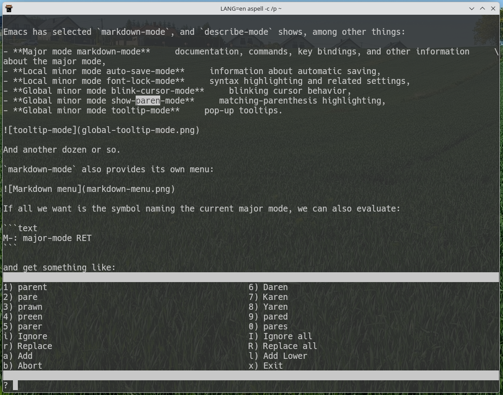
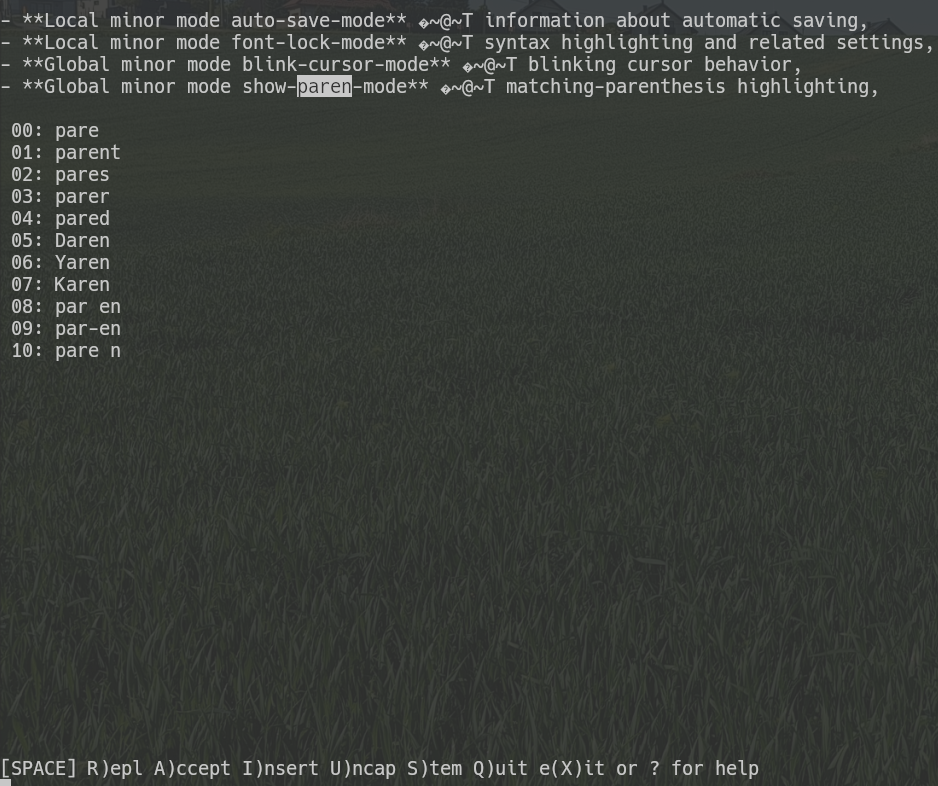
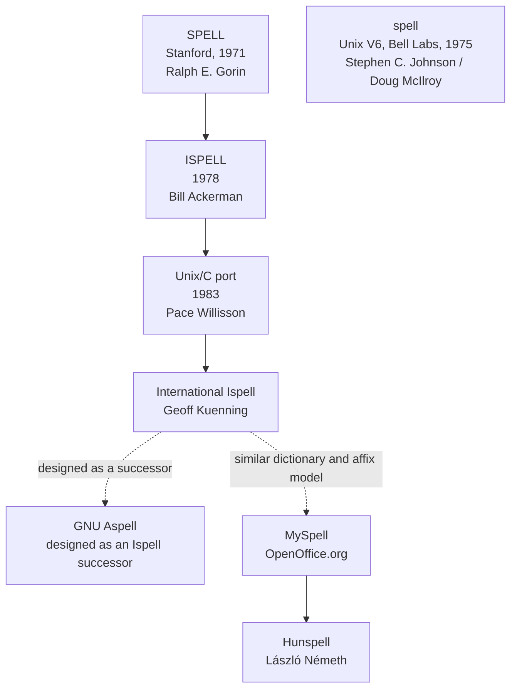
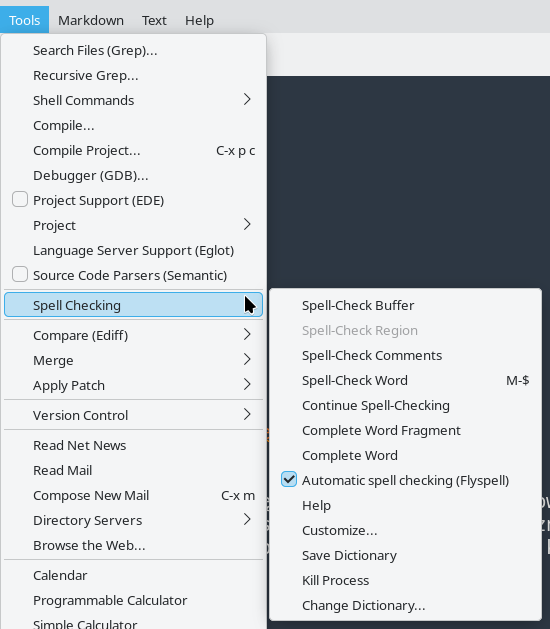
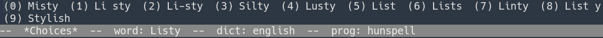
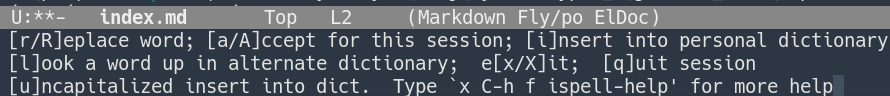
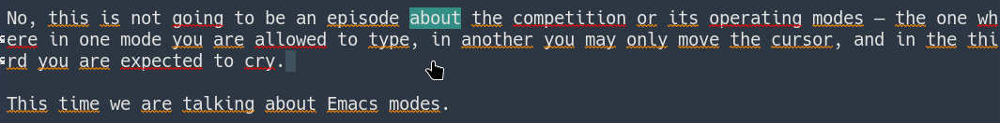
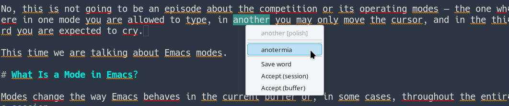
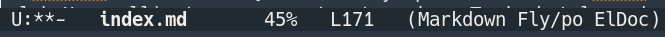

Whether you want the quick brown fox to jump over the lazy dog on Windows, have a black quartz sphinx judge your vow on a normal operating system, or simply write something using nothing but the Latin alphabet, traps are everywhere.

Too many typographical gremlins eventually produce mistakes we are ashamed of.

Mistakes unworthy of educated people.

Fortunately, computers have been pointing them out to us for a very long time.

# A Little History

The history of computer spell checking is considerably older than one might expect.

In 1971, **Ralph E. Gorin** at the Stanford Artificial Intelligence Laboratory wrote `SPELL` for a PDP-10 running WAITS.

It could not only detect unknown words but also suggest possible corrections.

A few years later, in 1975, another program called:

```text
spell
```

appeared at Bell Labs.

Written by Stephen C. Johnson and later improved by Douglas McIlroy, it followed a much more Unix-like philosophy.

It examined some text and printed the words it considered suspicious.

No dialogs.

No windows.

No questions.

It took a file, told you what was wrong, and terminated.

A respectable Unix program.

Meanwhile, the Stanford `SPELL` continued to evolve.

In 1978 Bill Ackerman renamed it:

```text
ISPELL
```

And here comes a small surprise.

The name did not originally mean _interactive spell_.

Ackerman later explained it as:

> ITS version of SPELL.

In 1983 **Pace Willisson** converted it to C and ported it to Unix.

In 1987 **Walt Buehring** published another version together with the first Emacs interface:

```text
ispell.el
```

and Geoff Kuenning later extended the program with multilingual support, producing **International Ispell**.

At this point the family tree begins to lead directly to software still in use today.

## Aspell

**GNU Aspell** was created as a more modern successor to Ispell.

Its goals included better correction suggestions, easier support for multiple languages, and convenient handling of UTF-8 documents.

Development proceeds at a rather dignified pace these days, but the project is by no means completely dead.

Aspell can naturally be used directly from a terminal.

And it does not look nearly as bad as you might expect:



## Hunspell

Another branch of the family tree produced **MySpell**, developed for OpenOffice.org.

MySpell later became the foundation for **Hunspell**, developed by László Németh.

Hunspell was designed to deal particularly well with things such as:

- Unicode,
- rich inflection,
- compound words,
- morphological analysis,
- languages such as Hungarian.

Hungarian is, after all, an excellent stress test for a spelling engine.

German is another one.

One day I really must feed Hunspell one of those famously absurd German compound words from old language jokes.

Assuming I can first determine how to spell it.

Hunspell is now extremely widespread. It is used by software including LibreOffice, Firefox, Thunderbird, and Chrome.

It can also be run directly:



The interface is somewhat more austere.

But it works.

It is immediately obvious that Hunspell is perfectly happy acting as an engine underneath another application with a nicer user interface.

The family tree can therefore be simplified rather aggressively:



The Unix `spell` utility is a separate, parallel branch of the story.

# Spell Checking in Emacs

Emacs, as one might expect, can work with several external spelling engines.

Current versions support, among others:

```text
Ispell
Aspell
Hunspell
Enchant
```

If only one of them is installed, Emacs can normally find it automatically.

If several are present, we can explicitly decide which one to use.

For historical reasons, almost every Emacs function, variable, and setting related to spelling still begins with:

```text
ispell-
```

Which program is actually running underneath is merely a configuration detail.

# Configuration

## Aspell

First, it is useful to see which dictionaries are installed:

```bash
aspell dump dicts
```

Their exact names depend on the packages installed on the system.

If the Polish dictionary is called `polish`, configuration may be as simple as:

```lisp
;; Use Aspell as the spelling engine.
(setq ispell-program-name "aspell")

;; Default dictionary.
(setq ispell-dictionary "polish")
```

That is essentially enough.

## Hunspell

Available dictionaries can be inspected with:

```bash
hunspell -D
```

Typical names look like:

```text
pl_PL
en_US
en_GB
pt_BR
```

Configuration:

```lisp
;; Use Hunspell as the spelling engine.
(setq ispell-program-name "hunspell")

;; Default dictionary.
(setq ispell-dictionary "pl_PL")
```

Hunspell dictionary names commonly include both language and region, so variants such as:

```text
en_US
en_GB
```

or:

```text
pt_PT
pt_BR
```

can be distinguished naturally.

The comments are, of course, optional.

But they may one day save us from asking:

> Why exactly did I put this here?

# Essential Commands

The command I use most often is:

```text
M-$
```

which runs:

```text
M-x ispell-word
```

It checks the word at or immediately before point.

If a region is active, `M-$` checks the entire region instead.

Other useful commands include:

- `M-x ispell-buffer` — check the whole buffer,
- `M-x ispell-region` — check the selected region,
- `M-x ispell-message` — check a mail or message draft while ignoring quoted material,
- `M-x ispell-comments-and-strings` — check only comments and strings,
- `M-x ispell-comment-or-string-at-point` — check the comment or string at point,
- `M-x ispell-change-dictionary` — switch dictionaries,
- `M-x ispell-kill-ispell` — terminate the spelling subprocess.

Yes.

Emacs has a dedicated command called:

```text
ispell-comments-and-strings
```

for checking spelling only inside source-code comments and strings.

Find that in a random text editor.

I'll wait.

The same commands are also available through the `Tools` menu:



# How Does It Work?

Run:

```text
M-x ispell-buffer
```

and Emacs walks through the current buffer.

When it encounters a word unknown to the selected dictionary, it opens:

```text
*Choices*
```

with suggested replacements:



The interface is fairly straightforward.

Suggestions have assigned keys or numbers; selecting one replaces the unknown word.

The echo area offers additional commands as well.

The most useful ones allow us to:

- accept the word unchanged,
- replace it with arbitrary text,
- add it to a personal dictionary,
- look up another word,
- interrupt or finish the session,
- display help.

The complete list of available commands is always available with:

```text
?
```

or:

```text
C-h
```



The mode line of the `*Choices*` window also shows useful information such as:

- the word currently being checked,
- the active dictionary,
- the spelling engine in use, such as `hunspell` or `aspell`.

# Flyspell

What about automatic checking?

The kind office suites do while you type?

Certainly.

That is the job of **Flyspell**, a minor mode which checks text as it is being edited:

```text
M-x flyspell-mode
```

Unknown words are highlighted:



Flyspell does not necessarily scan all pre-existing text immediately.

To check text that was already in the buffer, use:

```text
M-x flyspell-buffer
```

or, for a selected portion:

```text
M-x flyspell-region
```

Clicking a highlighted word with the middle mouse button (`mouse-2`) opens a correction menu:



Keyboard users are not forgotten.

For example:

```text
C-c $
```

opens a correction menu for the word before point.

# Flyspell in Text and Programming Modes

And this is where the previous two episodes finally become useful.

We already know what:

- major modes,
- minor modes,
- hooks

are.

So `init.el` can contain:

```lisp
;; Flyspell in text modes.
(add-hook 'text-mode-hook #'flyspell-mode)

;; In source code, check comments and strings only.
(add-hook 'prog-mode-hook #'flyspell-prog-mode)
```

The first line automatically enables `flyspell-mode` in modes derived from `text-mode`.

The second uses:

```text
flyspell-prog-mode
```

which behaves similarly but checks only comments and string constants.

It does not care about function names.

It does not care about variable names.

It will not attempt to turn:

```python
def calculate_something():
```

into proper Polish.

Which is probably for the best.

# Changing Dictionaries

When writing in several languages, the current dictionary can be changed with:

```text
M-x ispell-change-dictionary
```

Emacs asks for its name and changes the dictionary for the current buffer.

Naturally, we can create a shortcut.

For example, with Aspell dictionaries named `polish` and `english`:

```lisp
(defun switch-dictionary ()
  "Switch the spelling dictionary between Polish and English."
  (interactive)
  (let ((dictionary
         (or ispell-local-dictionary ispell-dictionary)))
    (ispell-change-dictionary
     (if (string-equal dictionary "polish")
         "english"
       "polish"))))

(global-set-key (kbd "C-c d") #'switch-dictionary)
```

With Hunspell the corresponding names may instead be:

```text
pl_PL
en_US
```

so only the two strings need to be changed.

Now:

```text
C-c d
```

switches languages in either direction.

With Flyspell running, the active dictionary is also visible in the mode line:



# Several Dictionaries at Once

Hunspell has one more interesting trick.

It can use several dictionaries simultaneously.

In Emacs, start with:

```text
M-x ispell-hunspell-add-multi-dic
```

and enter, for example:

```text
pl_PL,en_US
```

From then on, Hunspell can check text containing both Polish and English words without constant dictionary switching.

For technical writing, this can be extremely convenient.

It also has an obvious disadvantage.

If a misspelled Polish word happens to be a perfectly valid English word, the checker may accept it.

There are no perfect solutions.

Only increasingly elaborate Emacs configurations.

# Customize

To adjust spelling behavior to one's exact personal preferences, visit:

```text
M-x customize-group RET ispell RET
```

and:

```text
M-x customize-group RET flyspell RET
```

There are enough settings there to satisfy almost anyone.

And then create several entirely new requirements.

# Personal Dictionary

A spelling engine uses not only the standard language dictionary but also a **personal dictionary**.

This is where words accepted permanently end up:

- names,
- project names,
- technical terminology,
- words the checker has never heard of but we know perfectly well exist.

Its location is controlled by:

```text
ispell-personal-dictionary
```

If the variable is `nil`, the selected backend uses its normal default location.

Aspell, for example, may create something similar to:

```text
~/.aspell.en.pws
```

while Hunspell uses its own dictionary-dependent naming scheme.

If we want to provide an explicit file:

```lisp
(setq ispell-personal-dictionary
      (expand-file-name "personal-dictionary"
                        user-emacs-directory))
```

there is one small trap worth remembering.

With Hunspell, if an absolute personal-dictionary path is supplied, the file should already exist.

So creating it first is safest:

```bash
touch ~/.emacs.d/personal-dictionary
```

Unless there is a good reason to change the location, leaving the backend's normal default in place is generally the least troublesome option.

# Summary

Emacs does not attempt to become a spelling engine itself.

Instead, it delegates the actual linguistic work to specialized external tools such as Aspell or Hunspell and provides an unusually capable interface around them.

We can check:

- a single word,
- a region,
- an entire buffer,
- only comments and strings,
- text automatically with Flyspell,
- text and source code differently,
- personal dictionaries,
- several Hunspell dictionaries simultaneously,
- and configure the whole thing through Customize or Lisp.

The programs underneath have decades of history behind them.

The Emacs interface is not exactly new either.

And yet the whole arrangement still works remarkably well.

More importantly, after the previous three episodes, this:

```lisp
(add-hook 'prog-mode-hook #'flyspell-prog-mode)
```

no longer looks like an incantation copied from the Internet.

We know what it does.

That feels like progress.
