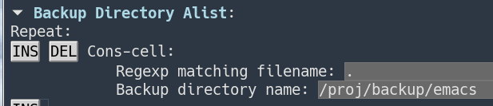

They say real tough guys don't make backups. That's one.
They say there are two kinds of people: those who make backups and those who will eventually start making them. That's two.
They say users of other editors envy Emacs users because Emacs makes backups for them. That's three.

As you have probably guessed, only the third statement is true.

In this episode, I'll cover three closely related subjects:

* backup copies,
* auto-saving,
* recovery.

# Backup copies

Traditionally, you might make a backup at the beginning of a work session to preserve, say, yesterday's results. Emacs handles this automatically: the first time you save a modified file, it backs up the file's previous contents. Another backup is normally made on the first save of the next editing session. (A small clarification: a new session can mean starting Emacs again later, or simply killing the buffer and visiting the file once more.)

That's a perfectly reasonable arrangement. But if you need backups more often, try `C-u C-x C-s`. There is a catch: it **saves the current version and marks it for backup the next time the file is saved**. The `C-u` prefix does not instantly produce an additional backup of the newly saved version.

Or you could write a function like this:

```elisp
(defun do-the-backup-now ()
  "Make an on-demand backup, for everyone."
  (interactive)
  (if (not buffer-file-name)
      (message "This buffer is not visiting a file.")
    (let ((buffer-backed-up nil))
      (backup-buffer)
      (message "Checked backup for: %s"
               (file-name-nondirectory buffer-file-name)))))
```

And call it whenever you like. The interesting part is `backup-buffer`, which is not an interactive command by itself. Remember, though: it backs up **the contents of the file on disk**, not unsaved changes in the buffer. It is no substitute for `save-buffer`. Also, `backup-buffer` respects Emacs's backup settings and restrictions; the message above is not an unconditional guarantee that a fresh file was created.

## How is a backup made?

There are two basic techniques:

* copy the original file under a new name,
* rename the original file and write the new contents under the old name.

Both have their advantages.

**Copying** is preferable if you need **hard links** to keep pointing to the same file that you are updating. If Emacs renamed the original file to become its backup, those hard links would continue to point to the old inode, while the newly saved file would have a different one.

**Renaming** can make more sense if hard links are not a concern and, for example, the local or remote filesystem is slow enough that copying a file would take a noticeable amount of time.

The preferred method is controlled by `backup-by-copying`:

* if it is non-`nil`, Emacs makes backups by copying,
* if it is `nil`, Emacs may make them by renaming the original file.

That is not an unconditional switch. Emacs also considers other settings and circumstances. For example, `backup-by-copying-when-linked` favors copying when a file has multiple hard links, while `backup-by-copying-when-mismatch` addresses situations involving differences in file ownership or group. So think of `nil` as permission to rename, rather than an ironclad order.

## Where do backups go?

By default, Emacs puts a backup next to the original file and appends a **tilde** to its name.

Of course, you can change that location. You can even send particular names, filename extensions (who came up with that ridiculous term?), or entire directory trees somewhere else, or exclude them from backups altogether.

As usual, it all comes down to a suitable portion of Emacs Lisp. Here the relevant variable is `backup-directory-alist`.

You can customize it with `M-x customize-variable`:



or put this in your `init.el`:

```elisp
(setq backup-directory-alist '(("." . "/proj/backup/emacs/")))
```

Separate directories for particular projects or paths? Certainly:

```elisp
(setq backup-directory-alist
      '(("^/proj/some/app/" . "/backup/some-app/")
        ("." . "~/my-backups/other/")))
```

Emacs checks the rules in order and uses the first match. The first item in each pair is a **regular expression**, not simply a directory name.

What will the backup be called? The authors of Emacs wisely noticed that different directories may contain files with identical names, so Emacs uses the original file's full path to avoid collisions, replacing directory separators (`/`) with exclamation marks. For example:

```text
!proj!cpp!mydockapp!src!main.c~
```

might be a backup of:

```text
/proj/cpp/mydockapp/src/main.c
```

Can you exclude particular files or directories? You certainly can:

```elisp
(setq backup-directory-alist
      '(("\\.gpg\\'" . nil)
        ("\\.vault\\'" . nil)
        ("." . "/proj/emacs/backup/")))
```

For files ending in `.gpg` or `.vault`, the destination is `nil`, which means **do not make backups of these files**. Note the distinction: a matching entry whose destination is `nil` disables backups for matching files, whereas setting the *entire* `backup-directory-alist` variable to `nil` simply restores the normal location beside the original file.

If the destination backup directory does not exist, Emacs will try to create it.

The path may also be relative, for example:

```elisp
(setq backup-directory-alist '(("." . "here-be-backup/")))
```

This may charmingly litter your directory tree with identically named subdirectories full of backups. A relative destination is resolved relative to the original file's directory.

## Backups and version control

By default, Emacs does not make backup copies of files managed by version control. After all, why would it? But merely placing a file inside a cloned repository does not mean it is actually tracked. If it is untracked, Emacs can still back it up.

Naturally, you can change this: set `vc-make-backup-files` to `t` and Emacs will also make backups of version-controlled files.

If you only want this behavior in a particular directory, put a `.dir-locals.el` file there containing:

```elisp
((nil . ((vc-make-backup-files . t))))
```

The initial `nil` means "apply this to all major modes."

You can also associate directory-local settings with a directory from your `init.el`:

```elisp
(dir-locals-set-class-variables
 'projects-with-backups
 '((nil . ((vc-make-backup-files . t)))))

(dir-locals-set-directory-class
 "/path/to/your/directory/"
 'projects-with-backups)
```

## Disabling backups

If backup copies get on your nerves, add this to `init.el`:

```elisp
(setq make-backup-files nil)
```

From that point on, all the wailing and gnashing of teeth over lost work is entirely your responsibility.

## Numbered backups

Emacs can number backup files, and anyone who uses backups will probably find that rather useful. Instead of keeping just one file with a trailing tilde, it creates a series:

```text
file.~1~
file.~2~
file.~3~
...
file.~1228~
...
```

Configure it like this:

```elisp
(setq version-control t
      kept-new-versions 5
      kept-old-versions 2
      delete-old-versions t)
```

Here:

* `version-control` enables numbered backups,
* `kept-new-versions` sets how many recent versions to keep,
* `kept-old-versions` sets how many of the oldest versions to keep,
* `delete-old-versions` controls whether excess versions are deleted automatically.

So, after evaluating that code, Emacs:

* creates numbered backups,
* keeps the 5 newest versions,
* keeps the 2 oldest versions,
* does not ask you for permission every time it deletes excess backups.

What about the versions between those two oldest and five newest copies? Well, they may be deleted during backup cleanup.

To avoid automatic deletion, the simplest solution is:

```elisp
(setq version-control t
      delete-old-versions 'never)
```

Alternatively, you could set `kept-new-versions` to some enormous number. But there is bound to be a nervous developer somewhere for whom a hundred thousand copies still won't be enough.

# Auto-saving

Another useful feature is auto-saving. Emacs writes a separate file containing changes you have made in the buffer but have not yet saved yourself. By default it attempts to do so:

* after roughly 30 seconds of inactivity,
* after 300 input events (usually keystrokes in practice).

It is not an absolutely rigid timer: for large buffers, Emacs may increase the idle timeout.

To change the event interval:

```elisp
(setq auto-save-interval 200)
```

And the idle timeout:

```elisp
(setq auto-save-timeout 20)
```

You can enable auto-saving by default in `init.el`:

```elisp
(setq auto-save-default t)
```

Or disable it for newly visited buffers:

```elisp
(setq auto-save-default nil)
```

This behavior is provided by `auto-save-mode`, which can also be toggled for an individual buffer with `M-x auto-save-mode`.

By default, the auto-save file for a local file is created in the same directory as the original, with a name like:

```text
#filename#
```

If you choose a separate directory and encode the entire path in the filename, it may look like this:

```text
#!path!to!file!filename#
```

How do you choose another directory? For example:

```elisp
;; 1. Create the target directory if necessary.
(defvar my-auto-save-dir
  (expand-file-name "auto-saves/" user-emacs-directory))
(make-directory my-auto-save-dir t)

;; 2. Send auto-save files there, preserving unique names.
(setq auto-save-file-name-transforms
      `((".*" ,my-auto-save-dir t)))
```

Why do we explicitly create the directory? Because Emacs does not automatically create the designated directory for auto-save files; it expects it to exist. You may encounter an auto-save error if you visit a new file in a directory that has not been created yet.

This expression is also worth a closer look:

```elisp
`((".*" ,my-auto-save-dir t))
```

The backquote introduces *quasiquotation*. The comma is `unquote`: it tells Lisp to evaluate the expression following it rather than keep the variable name as a literal symbol. Here, the list receives the current value of `my-auto-save-dir`. The final `t` tells Emacs to incorporate the original file's full path into the auto-save name, helping to prevent collisions.

You can force auto-saving of modified buffers with `M-x do-auto-save`.

## What about `auto-save-visited-mode`?

Despite the similar name, it is a different feature. Ordinary `auto-save-mode` puts unsaved text **in a separate auto-save file**. By contrast, `auto-save-visited-mode` writes changes **directly to the file you are visiting**, without waiting for you to press `C-x C-s`.

That can be convenient, but it can also make a change permanent before you meant to save it. It is worth knowing which of these features you have enabled. In addition, `auto-save-visited-mode` has its own interval (`auto-save-visited-interval`); the previously discussed `auto-save-interval` and `auto-save-timeout` do not control it.

# Recovering a file from auto-save

When you visit a file, Emacs may notice that a newer auto-save file exists and suggest `M-x recover-this-file`. The command lets you decide whether to recover the text or keep the current version; you can also inspect the differences.

Recovery means **loading the auto-saved contents into the buffer** in place of the version currently on disk. It does **not** immediately overwrite the original file. You can inspect what was recovered, undo changes, and then deliberately save with `C-x C-s` if you want to keep it.

Another useful command is `M-x recover-session`, which helps retrieve files after a particularly spectacular crash. Emacs displays information about interrupted sessions recorded by the auto-save system and lets you recover their associated files. It does not restore the entire desktop, window layout, or every buffer. Other features, including `desktop-save-mode`, are intended for that sort of job.

## An experiment for the skeptics

The best way to understand recovery is to see it work. Naturally, use **a test file and a separate Emacs instance**, not a dissertation you have spent the last three years writing.

1. Start a separate instance of Emacs and open a test file that you have already saved to disk.
2. Add a few sentences, but do not press `C-x C-s`.
3. Run `M-x do-auto-save` and verify that the auto-save file exists.
4. From another terminal, terminate **only that test instance** with `SIGKILL`, for example `kill -9 PID` (double-check the process ID!).
5. Visit the file again in Emacs and try `M-x recover-this-file` or `M-x recover-file`.
6. Compare the recovered text with the on-disk version and decide whether to save it.

Thanks for making it to the end of this episode. From now on, there will be no more excuses like "the dog ate my PhD thesis." Obviously, as of today, it will exist in 36 copies scattered across different locations!

One small warning before we finish: **Emacs backups are no replacement for proper backups**. If all 36 copies live on the same disk, a disk failure can devour them along with your thesis. No dog required.
